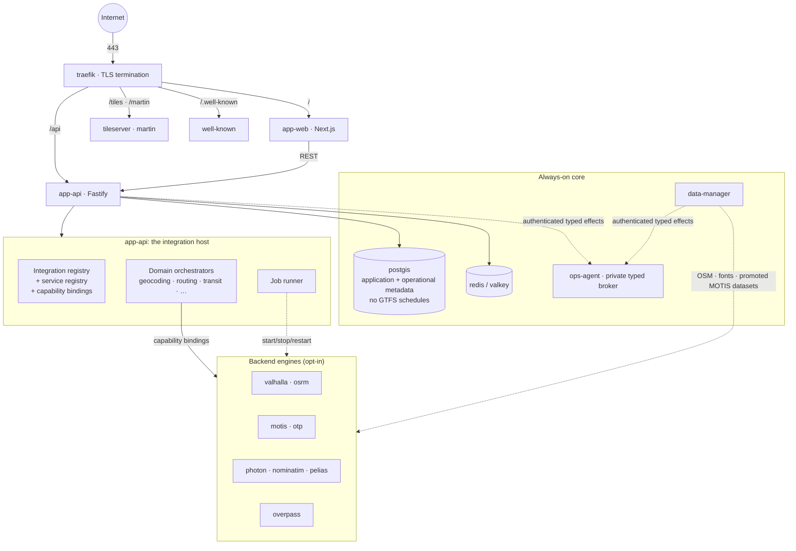
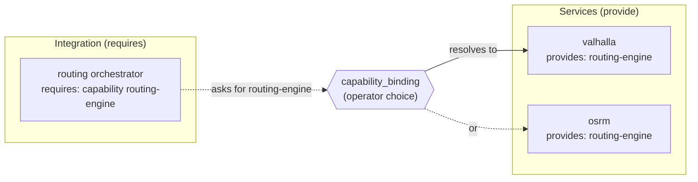
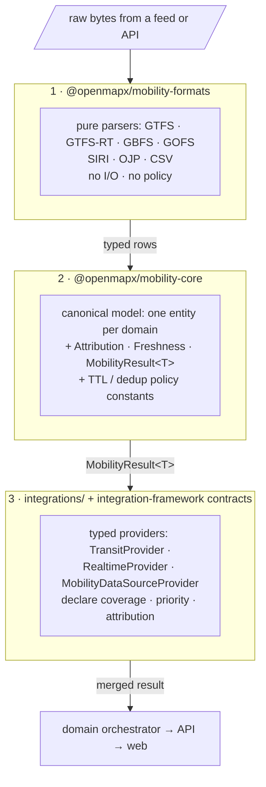

# Architecture

OpenMapX has two plugin systems: services run backend daemons, and integrations
provide application features. The Compose renderer selects and connects their
containers. This page describes the repository, runtime boundaries, capability
resolution, and mobility data flow.

If you are new to the project, read [How it works](../overview/how-it-works.md)
first. If you operate a deployment, [Managing services](../install/managing-services.md)
is the day-to-day companion to the runtime topology below.

The topology also defines who can see user data. Ordinary synchronized content
is processed by `apps/api` and is not end-to-end encrypted; server-side
credential encryption, TLS, signing, and client encryption are separate
controls. Read the [user-data trust model](./user-data-trust-model.md) before
adding a user-data field, cache, processor, or privacy claim.

## The monorepo

The repository is a [Turborepo](https://turborepo.com/) workspace driven by pnpm.
`pnpm-workspace.yaml` includes `apps/*`, `packages/*`, `integrations/*`,
and `services/data-manager`. `turbo.json` orchestrates build, development, start,
and type-check tasks. Portable tests run through the root Vitest configuration;
the native mobile app has separate Jest/native checks. The Node and pnpm versions are pinned in `.nvmrc` and the root
`package.json`.

```
openmapx/
├── apps/
│   ├── web/                  Next.js 16 frontend (MapLibre GL JS, MUI 9)
│   ├── api/                  Fastify 5 BFF + integration host + admin API
│   ├── ops-agent/            private typed operations broker
│   ├── transitous-runner/    isolated Transitous preparation runner
│   └── mobile/               Expo native host for the map and navigation
├── packages/                 shared libraries (see below)
├── integrations/             built-in application features (manifest.json each)
├── custom_integrations/      community integrations (gitignored)
├── services/                 built-in service plugins (service.json each)
│   ├── data-manager/         data preparation, publication and supervision
│   └── ops-agent/            private deployment manifest for the operations broker
├── infra/docker/             generated output + operator configuration/state
└── docs/                     this documentation site
```

The CLI writes generated Compose files, release overlays, and hardlink plans
under `infra/docker/`. That directory also contains operator input and durable
state, including `.env`, service selection, secrets, and data; it is not a
throwaway build directory. Do not hand-edit generated Compose output.

`custom_integrations/` holds installed declarative integration artifacts.
Community service repositories live under `services/.community/`, owned by the
operations agent. Built-in integrations run trusted host code; installed
community integrations cannot load arbitrary JavaScript into the API or web
process. Their executable behavior belongs in separate service containers.

### Applications

| App              | Stack                                                                                   | Responsibility                                                                                                                                                                                                                                                      |
| ---------------- | --------------------------------------------------------------------------------------- | ------------------------------------------------------------------------------------------------------------------------------------------------------------------------------------------------------------------------------------------------------------------- |
| `apps/web`       | Next.js 16 · React 19 · MapLibre GL JS 6 · MUI 9 · Zustand · TanStack Query · next-intl | The user-facing App Router UI. Layouts and request boundaries use Next.js normally; the interactive map, panels, and navigation shell are client components. The MapLibre instance is shared through React context rather than serialized into application state.   |
| `apps/api`       | Fastify 5                                                                               | The backend-for-frontend (BFF) gateway. It is _also_ the integration host: it discovers and configures integrations, runs trusted built-ins, hosts declarative community artifacts, resolves service requirements, enforces admin access, and runs background jobs. |
| `apps/ops-agent` | Fastify 5                                                                               | A private, authenticated broker for a closed set of typed Docker and trusted-repository effects. It has no public route, host port, or community network attachment.                                                                                                |

The web app calls the API for routing and other provider operations. The API
reaches bound engines over the Docker network or uses configured external
providers. Browser map resources can also use public tile/proxy routes shown
below; backend engines do not need public host ports.

The Expo app in `apps/mobile` hosts the web map and native navigation/location
services. `apps/transitous-runner` performs isolated preparation work. See the
[mobile architecture](./mobile-architecture.md) and
[transit integrations](./transit-integrations.md) for their separate execution boundaries.

### Key packages

Shared code lives in `packages/*`. Many packages expose TypeScript source.
Development hosts load or transpile that source; deployment builds may bundle
it. Check each package's exports and scripts before assuming it has a separate
build output. Server code should use focused server-safe entry points instead
of barrels that also export React hooks.

| Package                                                                                                                                                                                                                                                              | Owns                                                                                                                                                                                                                                                                                                     |
| -------------------------------------------------------------------------------------------------------------------------------------------------------------------------------------------------------------------------------------------------------------------- | -------------------------------------------------------------------------------------------------------------------------------------------------------------------------------------------------------------------------------------------------------------------------------------------------------- |
| `@openmapx/core`                                                                                                                                                                                                                                                     | The shared spine: domain types (`Place`, `Route`, geometry, `BBox`), Zustand stores, the typed API client, TanStack Query hooks, the strict ops-agent contract/client, and the **services framework** (manifest schema, registry, the compose renderer, the `DataManagerClient`, capability resolution). |
| `@openmapx/integration-framework`                                                                                                                                                                                                                                    | The manifest schema, registry, loader, the `IntegrationContext` runtime type, and the **typed provider contracts** (one per domain: `TransitProvider`, `RealtimeProvider`, `MobilityDataSourceProvider`, `GeocodingProvider`, `RoutingProvider`, `WeatherProvider`, and more).                           |
| `@openmapx/mobility-formats`                                                                                                                                                                                                                                         | Pure, stateless parsers over raw bytes: GTFS, GTFS-RT, GBFS, GOFS, SIRI, OJP, CSV. No I/O, no policy.                                                                                                                                                                                                    |
| `@openmapx/mobility-formats-tomp`                                                                                                                                                                                                                                    | The TOMP-API (OpenAPI-generated) client, split out so its codegen dependencies don't bleed into every bundle that touches the other formats.                                                                                                                                                             |
| `@openmapx/mobility-core`                                                                                                                                                                                                                                            | The canonical mobility model: one entity type per domain, plus `Attribution`, `Freshness`, `MobilityResult<T>`, the TTL/dedup policy constants, and the GBFS client.                                                                                                                                     |
| `@openmapx/db-schema`                                                                                                                                                                                                                                                | Drizzle ORM table definitions shared between `apps/api` and `services/data-manager` (job tables, feed state, provider health).                                                                                                                                                                           |
| `@openmapx/cli`                                                                                                                                                                                                                                                      | The `openmapx` operator command line: services, compose, data, integrations/extensions, users, backups, cache, Transitous, and diagnostic checks.                                                                                                                                                        |
| `@openmapx/i18n`                                                                                                                                                                                                                                                     | Locale JSON for `en` and `de`, plus a `check-translations` gate that fails CI when locales drift. Consumed by `apps/web` (next-intl) and `apps/api` (integration string lookups).                                                                                                                        |
| `@openmapx/presets`                                                                                                                                                                                                                                                  | OSM preset matching and category chips, built on iD's tagging schema.                                                                                                                                                                                                                                    |
| `@openmapx/ev-charge-planner`                                                                                                                                                                                                                                        | Pure EV trip planning: vehicle energy models, charge curves, corridor candidates, matrix scoring, network/availability/tariff policy, and itinerary estimates.                                                                                                                                           |
| `@openmapx/extension-cli`                                                                                                                                                                                                                                            | Community-extension manifest/service scaffolding, validation, and declarative packaging. Executable behavior belongs in an isolated service container.                                                                                                                                                   |
| `@openmapx/openconditions-contrib-client`                                                                                                                                                                                                                            | Browser-side device keys, structural validation and RFC 8785/ES256 signing of OpenConditions situation and observation claims, and signed votes on records for crowd reports.                                                                                                                            |
| `@openmapx/transitous-core`                                                                                                                                                                                                                                          | Shared Transitous catalog normalization and feed-selection logic used by the CLI, API, and data pipeline.                                                                                                                                                                                                |
| `@openmapx/place-ids`, `@openmapx/mangrove-client`, `@openmapx/mangrove-react`, `@openmapx/command-palette`, `@openmapx/noaa-coops-data`, `@openmapx/ourairports-data`, `@openmapx/hardlinks`, `@openmapx/motis-feed-proxy-config`, `@openmapx/hey-api-client-fetch` | Focused utilities: stable place identifiers, Mangrove review signing, the search palette, bundled open datasets (tide stations, airports), the local hardlink applier, the MOTIS feed-proxy nginx config renderer, and the workspace fetch runtime used by generated API clients.                        |

## Runtime topology

A deployment connects selected Docker containers through the generated network
configuration. Community services have a separate network boundary and receive
only the access declared by reviewed service contracts. The
[overview diagram](../overview/how-it-works.md#a-deployment-at-a-glance) shows
the shape; here is what each tier is actually doing.

<div className="docs-diagram" style={{"--diagram-min-width": "118rem"}} tabIndex={0} role="region" aria-label="Runtime topology diagram">



</div>

Traefik terminates TLS for the bundled proxy deployment. An operator can
configure an external proxy instead. Containers address bound services by
service ID, for example `http://valhalla:8002`. A manifest can expose a proxy
route through `exposure.proxy` or bind a host port through `exposure.hostPorts`
(loopback by default). Inspect those declarations when reviewing network access.
`app-web` claims `/` at the lowest proxy priority; more specific routes such as
`/api`, `/tiles`, `/martin`, and `/.well-known` take precedence.

**The always-on core.** A handful of services are selected by default:
`traefik`, `well-known`, `app-api`, `app-web`, `postgis`, `redis`, `data-manager`,
and `ops-agent`. Everything heavy (routing engines, geocoders, transit engines,
the Overpass server, tile servers) is opt-in: you add it to the _selection_ and
re-render. PostGIS is the system of record for application data and operational
pipeline metadata; it does not store GTFS schedules. Redis (Valkey) is the
cache.

**The private operations boundary.** `ops-agent` accepts only versioned,
short-lived requests from `app-api` or `data-manager`, authenticated with
distinct file-mounted bearer credentials. Its contract is a strict
discriminated union: callers cannot supply a command, arbitrary arguments,
Compose/YAML, environment maps, caller paths, or container names. The agent
maps authorized operation kinds to fixed runtime adapters and emits only
bounded structured audit fields. It is reachable solely on the private
`openmapx` network.

`ops-agent` is the sole owner of the Docker socket and trusted repository write
mounts, including the community service checkouts under `services/.community/`. `app-api` and `data-manager` submit typed operations instead of receiving
that host authority themselves. The agent's own state (job journal, self-update
handoff record, trusted-configuration queue and privacy-extraction scratch) lives
in `infra/docker/state/ops-agent/`, outside the data directory data-manager
mounts; `app-api` mounts only the queue, and `pnpm check-ops-authority` keeps it
that way. The built-in service manifests the agent and its
fixed CLI render come from the agent's own image, not from the host checkout.
A process cannot recreate its own container, so
to update itself the agent starts a short-lived helper container from its own
image. The helper has only the socket and checkout mounts, no network and no
capabilities. It replaces the agent container, verifies the new agent and exits. Traefik consumes generated configuration rather
than discovering containers through the Docker socket, so there is no duplicate
host-control path outside the broker.

`app-api` runs the integration host alongside core routes, service discovery,
and asynchronous jobs:

- Static routes registered directly on Fastify: `/health`, `/api/places`,
  `/api/isochrone`, `/api/tiles/*`, `/api/admin/*`, and so on.
- The **integration host**, which loads every trusted built-in integration's `setup(ctx)` and
  exposes their HTTP routes through a single dispatcher (more on this below).
- The **service registry**, which validates `service.json` manifests and answers
  "what's installed, what does it provide, what URL is it on."
- The job runner executes service lifecycle operations, data preparation, and
  community installs off the request path. The admin UI polls its progress.

A global `onRequest` hook applies tiered, IP-keyed rate limits. Admin route
scopes also enforce administrator authorization through their runtime guards. Fastify trusts
forwarding headers only when the socket peer belongs to an explicitly configured
proxy IP/CIDR range, so limiters and the audit log see the real client IP without
accepting headers from a directly connected client. The loopback admin
short-circuit deliberately reads the raw socket address, so a forged
`X-Forwarded-For` can't bypass it.

**The data plane behind the engines.** The `data-manager` service owns the
`/data` tree. It downloads OSM extracts and map glyphs, and runs the
transactional Transitous/operator-source pipeline that imports candidate static
schedules into an inactive MOTIS slot. OTP remains a separately configured
regional transit alternative with its own graph build. The data-manager
promotes a complete MOTIS candidate only after its
functional probes pass, so requested and active source state may differ and a
failed job preserves the prior live dataset. Shared artifacts are _hardlinked_
into consumer directories so several engines can use one multi-gigabyte file without another full copy on the same filesystem. The compose renderer plans those links from each service's
`consumes:`/`produces:` declarations; `data-manager` applies the plan. See
[Managing services](../install/managing-services.md) for the operator workflow.

## The capability model

Services and integrations never name each other directly when they can avoid it.
Instead they meet through **capabilities**: free-form strings like
`routing-engine`, `geocoder`, `transit-engine`, `tile-server`, `osm-query`.

<div className="docs-diagram" style={{"--diagram-min-width": "72rem"}} tabIndex={0} role="region" aria-label="Capability binding diagram">



</div>

- A **service** declares what it offers with `provides: [...]`.
- An **integration** declares what it needs with `requires: [...]`, either by
  capability (`{ "capability": "geocoder" }`) or by a specific service id
  (`{ "service": "valhalla" }`), and may mark a requirement `optional`.
- A **binding** resolves the two. When exactly one installed service satisfies a
  capability, the host auto-selects it. When several do, an operator picks one in
  the admin panel; that choice is stored in the `capability_binding` table and
  consulted at host startup. An unmet `optional` requirement falls through to the
  integration's own public-API fallback (for example, the routing orchestrator
  reaches the public Valhalla endpoint when no local router is bound).

Operators select a service that implements the required capability without
changing the consumer. Provider-specific capability limits and configuration
still apply.

### Domains and orchestrators

Every integration registers into one or more **domains**: `geocoding`,
`routing`, `transit`, `live-transit`, `data-source`, `poi-search`, `search-suggestions`, `photos`,
`reviews`, `weather`, `knowledge`, `map-overlay`, `street-level-imagery`,
`road-conditions`, `gtfs-catalog`. Domains with multiple providers use an **orchestrator integration** (`integrations/geocoding/`,
`integrations/routing/`, `integrations/transit/`, and so on) that owns the
domain's public API routes and a registry of providers. Provider integrations
declare a dependency on their orchestrator, so the host's topological sort always
loads orchestrators first.

The orchestrator's job is to merge across providers, and the strategy varies by
domain: geocoding and weather run a **fallback chain** (first non-empty wins);
data-source, photos, reviews, and poi-search **merge everything**; transit
**fans out and deduplicates** across providers matched by coverage box and
prefix; map overlays are **independent layers**. The transit orchestrator is the
most involved: it routes id-bearing requests by provider prefix (`bvg:`, `mo:`,
`g-<slug>:`), waterfalls trip-planning by priority, fans stops and alerts out in
parallel, and deduplicates overlapping results.

`search-suggestions` is a concurrent merge domain for exact place codes,
explicit aliases/references, and conservative acronyms. Its provider contract
returns normalized match evidence, stable/cross-source identifiers,
importance, and per-result attribution. The built-in providers adapt
OurAirports, the configured transit orchestrator, and the independently built
`osm_search` and `notable_places` PostGIS schemas. The second holds places
covered by many Wikipedias, with a `fame` value the ranker takes at face value,
so far-away landmarks outrank nearby namesakes whatever geocoder runs. This
domain deliberately does not replace the
geocoding fallback chain; `SearchBar` merges both responses after each has
applied its own semantics.

The client merge in `packages/core/src/utils/searchSuggestion.ts` gives exact
result IDs and shared external identities precedence over spatial heuristics.
Ordinary POIs require independent source-record namespaces, equivalent concrete
address context and compatible category/entity evidence; same name and proximity
alone must not erase separate branches or tenants. Manifest `sourceIds` are
attribution only. City, transit and landmark reconciliation remain entity-specific.
The [search policy](../features/search.md#keeping-distinct-places-in-the-list)
documents the fallback's conservative address limits and source-identity rules.

The OSM alias index is an ODbL-derived data product owned by `data-manager`.
The manager streams a selected PBF through Osmium into an
`osm_search__staging` schema, validates it, and atomically swaps it into
`osm_search`. Publication epochs invalidate provider caches without key scans,
and a failed rebuild leaves the previous live schema queryable. The
`notable_places` schema follows the same staging-and-swap pattern, filled from
a Wikidata SPARQL endpoint (CC0) instead of a PBF.

## The integration host lifecycle

When `apps/api` boots, the host runs the same sequence it re-runs on every hot
reload:

<div className="docs-diagram" style={{"--diagram-min-width": "84rem"}} tabIndex={0} role="region" aria-label="Integration host lifecycle diagram">


</div>

1. Discover: scan `integrations/` and `custom_integrations/` for
   `manifest.json`.
2. Validate: apply the manifest schema and business rules. Invalid manifests
   are skipped with a warning. Required host configuration can still fail
   startup, including a missing `OPENMAPX_SECRETS_KEY` for discovered
   integrations that declare vault-backed secrets.
3. Topological sort: order by each manifest's `dependencies:` so
   orchestrators load before their providers.
4. Resolve config: a five-layer cascade, highest wins: environment variable
   → local `config.json` → encrypted vault → database (admin UI) → schema
   default.
5. Resolve `requires:`: match each integration's requirements against the
   service registry and the capability bindings.
6. `setup(ctx)`: call every enabled built-in integration with a rich
   `IntegrationContext`. Through `ctx`, an integration registers providers
   (`ctx.registerTransitProvider`, `ctx.registerMobilityDataSource`,
   `ctx.registerProvider(domain, …)` for the rest), mounts HTTP routes
   (`ctx.registerRoute`), and reaches its cache, logger, secrets, and bound
   services.
7. Seed health: an initial health sweep runs ~5 s after startup and repeats
   every 60 s, populating the per-integration health the admin panel surfaces.

Integration HTTP routes are not registered as individual Fastify routes. They go
into one in-memory table that a single catch-all dispatcher consults, so a host reload can replace that table, rediscover manifests, resolve
bindings, and rerun setup without restarting the API.
`POST /api/integrations/reload` is registered only outside production;
production administration uses the authenticated integration lifecycle operations.

:::note[Production vs. development reload]
The host adds the backend entry file's mtime and size to its import URL in both
development and production. A changed entry can reload; unchanged entries reuse
Node's cached module. This does not invalidate unchanged URLs for transitive
imports. Restart `app-api` after changing already-loaded built-in code when a
reload cannot replace the complete module graph. Installed declarative artifacts
have their own reload lifecycle and do not execute a `setup()` module in the host.
:::

## The mobility data plane

Transit, shared mobility, parking, fuel, and EV charging use shared parsers,
canonical models, and typed provider contracts. Parsers
decode bytes; models define results and policy; integrations acquire and serve
evidence. Keep I/O and provider policy out of the parser layer.

<div className="docs-diagram" style={{"--diagram-min-width": "24rem"}} tabIndex={0} role="region" aria-label="Mobility data flow diagram">



</div>

**Layer 1: formats (`@openmapx/mobility-formats`).** Stateless functions over
bytes. `parseGtfsRealtime(bytes)` returns a typed feed message;
`parseSiri(xml)` decodes the envelope and a `siri-transit` companion normalizes
it toward the canonical model. These functions perform no network I/O or caching
and apply no provider policy. Request-path providers and offline validators can
reuse the same byte-to-row decoding. TOMP lives in the
sibling `mobility-formats-tomp` package only because its OpenAPI codegen pulls in
heavy dependencies that shouldn't ride along with the lean parsers.

**Layer 2: canonical model (`@openmapx/mobility-core`).** One TypeScript type
per domain entity (transit, shared-mobility, parking, fuel, EV-charging), one
`Attribution` shape, one `Freshness` envelope, and one wrapper that every
provider returns:

```ts
interface MobilityResult<T> {
  data: T;
  attributions: Attribution[];
  freshness: Freshness;
}
```

Because `Attribution` and `Freshness` are defined once, the orchestrator can
merge and deduplicate provider attributions while preserving contributor
precedence. The UI renders retained sources through shared attribution helpers.
Providers must still capture the correct receipts, and views must project only
the items and fields they display. The TTL and dedup _policy_ (cache
lifetimes per data class, dedup radii, name-similarity thresholds) lives in one
`policy.ts`, so cache and deduplication behavior is consistent across every
mobility domain rather than reinvented per integration. This layer also carries
the GBFS client and station resolver that shared-mobility providers build on.

**Layer 3: providers (`integrations/*`).** A concrete provider implements one
of the typed contracts in `@openmapx/integration-framework/src/contracts/`:
`TransitProvider` (stops, departures, planning, alerts, with a capability bitmap
so the orchestrator dispatches by declared capability rather than reflection),
`RealtimeProvider` (vehicle positions, trip updates, situation feeds), or
`MobilityDataSourceProvider` (bike/scooter/car-sharing). Parking, fuel, EV
charging, and webcams read OpenConditions through the typed `ParkingSiteProvider`,
`FuelStationProvider`, `ChargingSiteProvider`, and `CameraProvider` contracts. Each provider declares its coverage box, priority, and a static
`attribution`, and returns `MobilityResult<T>`. The orchestrator dispatches on
capability, coverage, and current health.

### Why split it this way

A shared parser fixes decoding for all consumers. Canonical models let
orchestrators combine providers without redefining each entity. Required
attribution and freshness fields keep those obligations at the provider boundary.
A new mobility provider should implement the existing contract and reuse the
shared parsers and model.

The same `MobilityResult<T>` discipline does **not** extend to the non-mobility
domains (geocoding, routing, weather, reviews, photos, knowledge), which still
have domain-specific provider contracts registered through
`ctx.registerProvider(domain, …)`. Their orchestrators own the merge semantics.
Air quality has a separate canonical evidence/standards model in
`@openmapx/air-quality`; see the [provider guide](./air-quality-integrations.md).

### Bulk datasets live in OpenConditions

Registries too large to fetch per request (national EV-charging, parking, fuel
and traffic-camera registers) and the hazard feeds (weather alerts, fire
detections, earthquakes, natural events) are not ingested by OpenMapX.
OpenConditions fetches, parses and links them, and OpenMapX's orchestrators read
the result through the `charging-sites`, `parking-sites`, `fuel-stations`,
`cameras` and `hazards` providers, so bulk datasets present the same canonical
shape as every other source.

## Where to go next

- [Integration system](./integration-system.md): the manifest, the
  `IntegrationContext`, domains, and config resolution in depth.
- [Service manifest](./service-manifest.md): the `service.json` schema,
  capabilities, exposure, and data sharing.
- [Writing an integration](./writing-an-integration.md): build a provider
  end to end.
- [CLI reference](./cli-reference.md): every `openmapx` command.
- [Development setup](./development-setup.md): run the stack locally.
