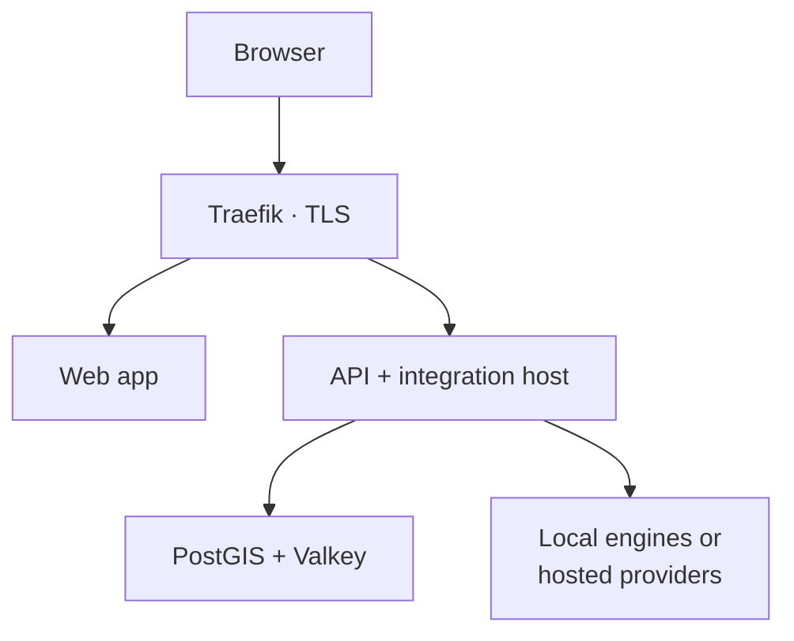

# How it works

OpenMapX is built from two plugin layers and a compose renderer that wires them
into a running stack.

## Services: the backend layer

A **service** is a backend daemon that runs as a Docker container: a database, a
routing engine, a geocoder, a transit engine, a tile server. Each one is
described by a `service.json` manifest under `services/<slug>/` that declares:

- the container image, ports, and volumes;
- the **capabilities** it provides (for example `routing-engine`, `geocoder`,
  `transit-engine`, `tile-server`);
- the data it **consumes** (OSM extracts, GTFS feeds, prepared tiles);
- how, if at all, it is exposed outside the host.

You enable the services you want and run `openmapx compose render` (or apply
changes in the admin panel); the renderer reads the enabled manifests and writes
the compose file as a new configuration generation. There is no hand-maintained
compose file.

## Integrations: the feature layer

An **integration** is an application feature. Built-in integrations have a
`manifest.json` under `integrations/<id>/`. They supply the
geocoding orchestrator, the routing orchestrator, transit providers, map
overlays, external data sources, photos, reviews, and place enrichment. A
manifest declares the integration's domain, runtime entry points, typed
configuration schema, attribution, and required services.

Installed community extensions use a declarative contract. Features that need
executable backend code run in a separate service container. Installing an
extension does not load its arbitrary JavaScript into the trusted API or web
process. See [Community extensions](../administration/community-extensions.md)
before adding a third-party source.

## Capabilities tie the two together

Services _provide_ capabilities; integrations _require_ them. This indirection is
how an integration finds a compatible backend. A requirement for a
`routing-engine` can be satisfied by a service that declares that capability.
When more than one service can satisfy a requirement,
an administrator picks the binding.

## A deployment at a glance

The diagram follows application requests. Data preparation and host operations
are covered in [Architecture](../developer/architecture.md#runtime-topology).

The core containers communicate over the private `openmapx` Docker network.
The reverse proxy's listeners and explicitly published service ports are the
host entry points. Ports bound to loopback are reachable only from the host.
The API server (`app-api`) is itself a
container: it hosts the integration framework, gates the admin endpoints, and
resolves integration requirements against the service registry.

## Where data comes from

The data-manager service owns the
`/data` tree: it downloads OSM extracts, GTFS feeds (via Transitous), and glyph
fonts (`tile-fonts`), prepares artifacts for enabled engines, and uses hardlinks where
appropriate so services can share files without copying them. Map styles and sprites are statically
bundled directly into the `app-web` frontend. The private **ops-agent** broker
keeps Docker socket and host lifecycle authority out of application containers. Some integrations call external APIs for traffic, street-level imagery,
or regional transit. Provider requests normally pass through the API. Browser
capabilities and explicit external links have separate privacy boundaries; check
the relevant feature guide and the instance's privacy information.

## Where to go next

- **[Getting started](../install/getting-started.md)** — set up your own
  deployment with Docker Compose.
- **[Architecture](../developer/architecture.md)** and the
  **[integration system](../developer/integration-system.md)** — a deeper look at
  how OpenMapX is built.
